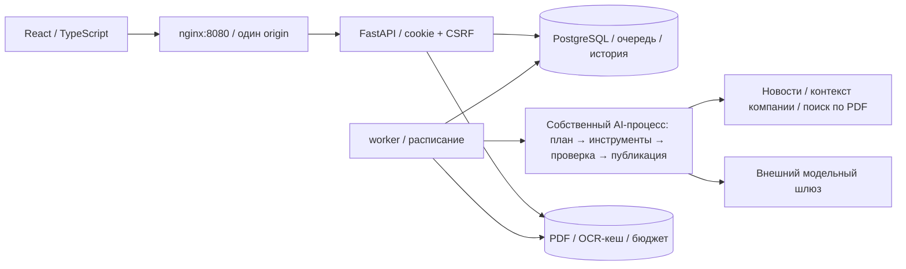

# GOAT_hack — персональная бизнес-аналитика

Сервис превращает новости в проверяемые выводы для конкретной компании и должности. Пользователь получает персональную ленту, открывает причины и источники, задаёт вопросы AI и сохраняет обратную связь. Неизвестные параметры обозначаются явно; историческая аналитика банка содержит дату. Альфа-Бизнес, SSO и обращение к менеджеру **смоделированы**: вход локальный, демо-действие не отправляет запрос в банк.

**Работающий стенд:** <https://shenti.space>. 
[Состояние комплекта и ограничения](docs/release/STATUS.md), [сценарий демонстрации](docs/demo/runbook.md), [презентация HTML](docs/release/presentation.html) / [PDF](docs/release/presentation.pdf).

## Что потребуется

- Git и Docker с Linux containers; Docker Compose **2.24.4+** (для acceptance-overlay используется [`!override`](https://docs.docker.com/reference/compose-file/merge/#replace-value)). Проверка: `docker version` и `docker compose version`.
- Ориентир для небольшого стенда: 4 CPU, 8 ГБ RAM и 10 ГБ свободного места; (рекомендация).
- Доступ к registry образов и пакетам при первой сборке. На хосте Python/Node/PostgreSQL для работы сервиса не нужны.
- Для настоящих карточек, чата и OCR — действующий серверный ключ командного AI-шлюза и согласованный лимит. Без ключа работают инфраструктура, регистрация, доступы и интерфейс, но AI не подменяется готовыми ответами.
- Для позиции банка — предоставленные организаторами PDF из `data2`. Они и клиентские CSV не публикуются в репозитории. Синтетический сценарий ниже не требует CSV.

## Развёртывание на своей машине

Все команды выполняются **из корня полученного репозитория**. Пример PowerShell:

```powershell
git clone https://github.com/TheDucklet/GOAT_hack.git
cd GOAT_hack
Copy-Item .env.example .env
Copy-Item .env.ai.example .env.ai
```

Linux/macOS: используйте `cp .env.example .env` и `cp .env.ai.example .env.ai`. Если нужна точная версия сдачи, перед запуском выполните `git checkout <commit-из-manifest>`.

В `.env` установите собственные `POSTGRES_PASSWORD` и `DEMO_PASSWORD` (минимум 10 символов). Для простого локального запуска пароль БД должен состоять из букв/цифр; пароль со спецсимволами задавайте через percent-encoded `DATABASE_URL`. Не коммитьте эти файлы. Если 8080 занят, измените одновременно `WEB_PORT` и `PUBLIC_ORIGIN`.

В `.env.ai` заполните `AI_LLM_API_KEY`, проверьте `AI_LLM_BASE_URL` и задайте согласованный `AI_LLM_DAILY_LIMIT_RUB`. В примере стоит **25 ₽/сутки**; пример не содержит ключа. Для проверки инфраструктуры поле ключа можно оставить пустым. Периодический сбор новостей в `.env.example` отключён: это позволяет сначала подготовить корпус и ограничить расходы.

```powershell
docker compose up --build -d --wait --wait-timeout 240
docker compose ps
docker compose exec -T api python -m app.cli seed-showcase
```

Откройте <http://localhost:8080>, [health](http://localhost:8080/health), [Swagger](http://localhost:8080/api/docs). Миграции выполняются автоматически до запуска API. Повторный `seed-showcase` не размножает данные и сохраняет существующие пароли. Он создаёт компании, членства и одну публичную новость, **без обращения к AI**. При коллизии с чужими demo-ID/аккаунтами завершится ошибкой; используйте отдельную БД, не удаляйте рабочую.

| Тестовый email | Компания / `company_id` | Должность |
| --- | --- | --- |
| `showcase_metal.accountant@goat.example.org` | Учебная компания «Металл» / `showcase_metal` | Главный бухгалтер |
| `showcase_metal.finance@goat.example.org` | `showcase_metal` | Финансовый директор |
| `showcase_build.accountant@goat.example.org` | Учебная компания «Строй» / `showcase_build` | Главный бухгалтер |
| `showcase_build.finance@goat.example.org` | `showcase_build` | Финансовый директор |
| `admin@goat.example.org` | Администратор, без членства в компаниях | Администрирование |

Пароль новых аккаунтов — заданный вами `DEMO_PASSWORD`. Существующий admin сохраняет свой пароль. Эти данные синтетические; предсозданные сотрудники нужны для быстрого сравнения, ручная регистрация проверяется отдельно.

## Подготовка банковских материалов и AI

1. Войдите администратором и откройте `/admin/documents`. Загрузите выданные организаторами PDF, задайте настоящие даты документов, запустите индексирование и дождитесь завершения (статус документа `done`). Начните с одного материала, например `Inflation_tracker_02.pdf`, и проверьте расход до загрузки остальных. [Имена/даты/SHA-256 ранее проверенного корпуса](docs/release/materials.json), [обновление корпуса](docs/demo/material-operations.md).
2. Сканы требуют платного OCR и отправки изображений на настроенный шлюз. Перед запуском оператор должен согласовать такую обработку и бюджет. Для прежнего локального стенда использовался ранее полученный OCR; новая копия репозитория его не содержит. Текстовые PDF обрабатываются без подмены содержимого. Ошибку/пустой корпус нельзя считать готовой позицией банка.
3. После подготовки корпуса обработайте baseline-новость явно:

```powershell
docker compose exec -T api python -m app.cli seed-showcase --enqueue
```

4. В `/admin/jobs` дождитесь завершения `summarize`. Откройте «Бизнес-аналитику» сотрудником: worker подготовит до двух готовых карточек. Первый проход может занимать несколько минут; следите за заданием, не отправляйте повторно вопрос из-за ожидания. Важны статусы `ready/partial/failed`, а не только HTTP 200.
5. Для свежих RSS после демонстрации нажмите «Собрать новости» в `/admin/news` или выполните `docker compose exec -T api python -m app.cli collect-news`. Для расписания задайте `NEWS_COLLECTION_ENABLED=true` и пересоздайте API/worker. Лимит одной подборки — `NEWS_MAX_NEW_PUBLICATIONS`; это не денежный лимит.

Счётчик расходов API и worker общий, хранится в томе документов. Проверять именно настроенный лимит:

```powershell
docker compose exec -T api python -c "from app.ai.providers.budgeting import default_ledger; from app.ai.providers import get_llm_settings; print(default_ledger(get_llm_settings()).status())"
```

Нельзя обнулять журнал бюджета или создавать новый том ради обхода лимита. При отсутствии/исчерпании ключа новые генерации недоступны, сохранённые карточки остаются в базе.

## Испытания: регистрация → карточка → чат → действие

Полная матрица, ожидаемые результаты и отрицательные проверки — в [runbook](docs/demo/runbook.md). Краткий проход:

1. На `/register` зарегистрируйте **новый** email с паролем от 10 символов. На экране «Компании и профиль» подайте заявку на `showcase_metal`, укажите должность и интересы. До подтверждения аналитика компании недоступна.
2. В другом профиле браузера войдите администратором. В `/admin/memberships` найдите заявку по email и подтвердите. В окне сотрудника нажмите «Обновить доступ».
3. Откройте «Бизнес-аналитику» и дождитесь подготовки. На карточке должны быть персональный вывод, механизм, неизвестные параметры и состояние актуальности. `undetermined` означает недостаток оснований для силы влияния, а не низкое влияние.
4. Откройте анализ: проверьте исходную новость и поле компании; при наличии банковского основания откройте PDF на указанной странице, сравните цитату и дату. При отсутствии подходящего документа допустимо «позиция банка не подтверждена»; исторический материал не является текущим заявлением банка.
5. Задайте «Как эта новость может повлиять на нашу компанию? Отдели факты от условий и перечисли, каких данных не хватает». Затем: «Какие данные мне как финансовому директору нужно проверить в первую очередь?». Дождитесь завершения каждого задания. Ответ должен опираться на доступные основания, без выдуманных выручки, долга или суммы экономии. Перезагрузите страницу — история должна сохраниться.
6. Оцените «Полезно», выполните «Обсудить с менеджером» и подтвердите **демонстрационное** действие. Запрос в банк не отправляется. Скройте событие, найдите его в «Скрытых» и верните.
7. Повторите одну и ту же новость четырьмя аккаунтами из таблицы: две компании × две должности. У «Металла» кредит отмечен, у «Строя» — нет, отмечен депозит. Ни ставка/сумма договора, ни свободные средства этим не подтверждаются.
8. Добавьте новость, ещё не показанную в baseline этого demo:

```powershell
docker compose exec -T api python -m app.cli seed-showcase --phase unseen --enqueue
```

В `/admin/news` появляется отдельный пресс-релиз об отзыве лицензии НКО «Тайдон». Обработайте и откройте его в ленте/анализе. Отсутствие подтверждённой связи компании с НКО должно сохраняться как неизвестное; отказ от сильного вывода или низкая релевантность допустимы. Это демонстрационная новизна, **не независимый held-out benchmark F-16**.

## Проверки без платного AI

Для воспроизводимой проверки инфраструктуры возьмите **отдельную копию** репозитория и свободный порт, например 8096. В её `.env` задайте `WEB_PORT=8096`, `PUBLIC_ORIGIN=http://localhost:8096`, `NEWS_COLLECTION_ENABLED=false`, `AI_ENV_FILE=.env.ai.example`. Нужен Python 3.10+ только для проверяющего скрипта:

```powershell
docker compose -p goat-r12-check up --build -d --wait --wait-timeout 240
python scripts/verify_compose_config.py
python scripts/verify_compose.py --project goat-r12-check --base-url http://localhost:8096 --report artifacts/r12-compose.json
```

Скрипт проверяет четыре healthy-сервиса, nginx/API/OpenAPI, регистрацию, cookie/CSRF, права и **пересоздаёт указанный стек** с проверкой сохранности данных/сессии/файлов. Он не проверяет качество настоящей LLM. Не направляйте его на рабочий стенд.

CI выполняет frontend contracts/architecture/tests/build, backend Ruff/pytest на PostgreSQL и Compose smoke без AI-ключей. Для разработки: [backend](backend/README.md), [frontend](frontend/README.md). Из `backend` с Python 3.12: `python -m pip install -r requirements.lock`, `python -m pytest -q`; из `frontend` с Node 24.22.0: `npm ci`, `npm test`, `npm run build`.

## Необязательный импорт данных кейса

Для испытаний на предоставленных CSV используйте отдельное окружение/БД. Папка `../data1` должна содержать исходные `df_Uid_data_hack.csv`, `df_Fid_Uid_link_hack.csv`, `df_Uid_payment_hack.csv`. Из корня репозитория, при запущенном целевом стеке:

```powershell
docker compose cp ../data1 api:/tmp/goat-input
docker compose exec -T api python -m app.cli import-clients --directory /tmp/goat-input --report /srv/backend/storage/import-report.json
docker compose exec -T api python -m app.cli demo-companies --limit 5
```

Последняя команда показывает реальные доступные `company_id` для заявки, а не названия компаний. Отчёт импорта сохраняется в постоянном хранилище. Не публикуйте CSV/отчёт с клиентскими данными. Импорт не требует их отправки LLM; [семантика и ограничения полей](docs/data/data-semantics.md).

## Архитектура и конфигурация



`frontend/src` организован по `app/features/shared`; `backend/app/api` — HTTP, `services` — доменная логика, `integrations` — контракт AI, `ai` — агент/поиск/генерация/проверка, `worker` — выполнение очереди. API не запускает планировщик. БД и API не публикуют свои порты на хост; документы доступны через защищённый API. [Границы модулей](docs/architecture.md), [OpenAPI](docs/contracts/openapi.json), [контракт AI](docs/contracts/integration.md), [инсайт v2](docs/contracts/insight-v2.md).

| Переменная / файл | Назначение |
| --- | --- |
| `.env` | Настройки Compose, БД, origin, seed, расписание; копируется из `.env.example` |
| `WEB_BIND_HOST`, `WEB_PORT`, `PUBLIC_ORIGIN` | По умолчанию `127.0.0.1`, `8080`, `http://localhost:8080`; origin должен точно совпадать с адресом браузера |
| `POSTGRES_USER/PASSWORD/DB`, `DATABASE_URL` | Подключение к БД; изменение пароля в env не меняет пароль уже созданного PostgreSQL-тома |
| `ENVIRONMENT`, `COOKIE_SECURE` | Локально development/false; внешний HTTPS — production/true |
| `DEMO_PASSWORD` | Только явно запускаемые seed-команды; существующие пароли не обновляет |
| `AI_ENV_FILE` | Серверный env-файл только для API/worker, по умолчанию `.env.ai` |
| `AI_MODULE`, `AI_LLM_API_KEY`, `AI_LLM_BASE_URL` | `app.ai.bridge`, секретный ключ и адрес шлюза; полный список — [AI README](backend/app/ai/README.md) |
| `AI_LLM_DAILY_LIMIT_RUB` | Денежный лимит; в `.env.ai.example` 25 ₽/сутки |
| `NEWS_COLLECTION_ENABLED`, `NEWS_MAX_NEW_PUBLICATIONS`, `NEWS_POLL_MINUTES` | Расписание, предел подборки, интервал; в `.env.example` false / 5 / 20 |
| `FEED_PREPARE_TOP_K`, `FEED_CANDIDATE_LIMIT` | В примере 2 готовые карточки из не более 10 кандидатов |
| `WORKER_POLL_SECONDS`, `JOB_TIMEOUT_SECONDS`, `MAX_PDF_BYTES` | Интервал worker, срок обнаружения потерянного задания, предел загрузки PDF |

Версии Python 3.12.14, Node 24.22.0, PostgreSQL 17.10 и nginx 1.30.2 закреплены digest в Dockerfiles/Compose; зависимости — в `backend/requirements.lock`, `frontend/package-lock.json`, Actions — SHA. [Компоненты, модели, данные и имитации](THIRD_PARTY_NOTICES.md).

## Внешний хостинг и эксплуатация

На Linux-сервере используется тот же Compose. Настройте внешний TLS reverse proxy/Cloudflare Tunnel на `127.0.0.1:8080`, `PUBLIC_ORIGIN=https://ваш-домен`, `ENVIRONMENT=production`, `COOKIE_SECURE=true`; затем пересоздайте API/worker. Прокси должен передавать `/api`, `/health`, `/openapi.json` и SPA на этот же origin. Обеспечьте HTTPS, HTTP→HTTPS, постоянные тома, резервную копию БД/PDF и доступ сервера к шлюзу. При Cloudflare DNS одного DNS недостаточно: нужен Tunnel либо маршрутизация/NAT до прокси. Публичный пароль из примера замените до публикации.

```powershell
docker compose logs --tail 100 api worker
docker compose restart
docker compose down
docker compose up -d --wait
```

Обычный `down` сохраняет named volumes `postgres_data` и `documents`. **Не используйте `down -v` на стенде с данными.** Скопируйте backup наружу из `/srv/backend/storage` и сделайте PostgreSQL dump до обновления. Данные БД и файлы нужно восстанавливать согласованно; `.env.ai` храните отдельно от публичных артефактов.

| Симптом | Действие |
| --- | --- |
| 403 при входе/изменении | Проверьте точный `PUBLIC_ORIGIN`, CSRF и secure-cookie при HTTP/HTTPS |
| Нет компании | Используйте `showcase_metal`/`showcase_build`; дождитесь одобрения членства |
| Пустая лента / queued | Проверьте `/admin/news`, summarize и `/admin/jobs`, ключ, бюджет и worker |
| Генерация failed / ответ не подтверждён | Сохраните job/event ID и ошибку; это не готовый инсайт. Повтор запускается явно из соответствующего экрана |
| Нет позиции банка | Проверьте готовые документы (`done`) и даты; отсутствие релевантного материала допустимо |
| Вход завис во время генерации того же пользователя | Известна длительная блокировка сессии worker-транзакцией; дождитесь её завершения, затем повторите вход |
| После аварии running/failed | Дождитесь `JOB_TIMEOUT_SECONDS`, проверьте `worker_lost`; автоматическое возобновление не гарантируется |

## Версия для сдачи

[Комплект](docs/release/STATUS.md) содержит CJM, метрики с ограничениями, презентацию и журнал проверок. Для архива ровно закоммиченной версии нужен Git и Python 3.10+:

```powershell
git rev-parse HEAD
python scripts/release_manifest.py
```

В `artifacts/release` появятся ZIP исходников, `manifest.json` с полным commit/tree SHA, SHA-256 архива и каждого файла, а также **`submission.html` для отправки организаторам**. Откройте его в браузере и выберите «Печать → Сохранить как PDF»: документ содержит ссылки на репозиторий, README, стенд и точную версию. Скрипт отказывается экспортировать незакоммиченные изменения. Для существующего тега: `python scripts/release_manifest.py --tag <тег>`; тег должен указывать на HEAD. **В заявку переносите SHA из manifest, не SHA из старого отчёта.** Репозиторий публичный, доступ `alfa-hack-2026` на чтение проверен. Секреты и данные рабочего стенда в архив не входят; доступы к hosted demo передаются оператором отдельно.
