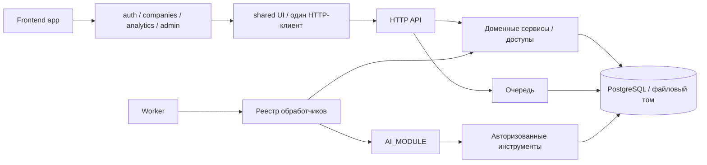

# Архитектура и правила расширения

Ветка `R-00-merge` продолжает R-03 (`83da4f7`) и содержит frontend, backend A-13 и Compose/CI. Основания: все четыре PDF из `output/planning`: описание системы и персональные планы Романа, Алексея и Фёдора; их задачи также перечислены в [TASKS.md](../TASKS.md). Архитектура остаётся модульным приложением с отдельным worker, PostgreSQL и файловым томом. Этот документ описывает текущее устройство и места расширения; будущие задачи не выдаются за реализованные.

## Структура репозитория

```text
frontend/
  src/
    app/                         сборка маршрутов и layout
    features/
      auth/                      вход, регистрация, состояние сессии, свой API
      companies/                 выбор компании, членства, профиль, свой API
      analytics/                 экран аналитики и запросы ленты/карточки/чата/jobs
      admin/                     административный экран и его API
      overview/                  обзор рабочего пространства
    shared/
      api/                       один HTTP-транспорт, ошибки, generated types
        mock/                    только dev-адаптер по опубликованным примерам
      ui/                        FormField, ErrorNotice
      styles/                    общие основы, формы и компоненты
      test/                      setup и композиция API только для тестов
    styles.css                   композиция стилей по владельцам
    main.tsx                     вход BrowserRouter/React
  scripts/                       проверки границ импортов и их контрольные тесты
  tests/                         браузерные проверки dev/HTTP/настоящего стека
backend/
  app/
    api/                         HTTP-роутеры, зависимости и обработчики ошибок
    services/                    операции предметной области
      access.py                  права на компанию и объект
      sessions.py                пароли и серверные сессии
      clients.py, news.py        импорт/агрегаты и сбор новостей
      ranking.py, focus.py       ранжирование и фокус пользователя
      events.py, insights.py     снимок события, версии/ключ карточки
      evidence.py, audit.py      проверка оснований, трассы, единый аудит
      tools.py                   авторизованные инструменты и BankRepository
      queue.py                   постановка и атомарный захват заданий
      scheduling.py              расписание и восстановление прерванных заданий
      jobs.py                    транзакции, повторы и исполнение worker
      job_handlers/              реестр и обработчики news/documents/analysis
    integrations/ai.py           единственная граница вызова AI_MODULE
    models.py, db.py             общая модель данных и подключение
    schemas.py, contracts.py     согласованные структуры и каталог HTTP-операций
    config.py, errors.py         настройки и общая ошибка без HTTP
    security.py                 HTTP-зависимости аутентификации
    main.py, worker.py, cli.py   отдельные точки запуска
  migrations/                    Alembic, одна история схемы БД
  tests/                         изолированные тесты, factories.py, fake_ai.py
scripts/                         Compose-приёмка и общая проверка архитектуры
docs/contracts/                  опубликованные OpenAPI/примеры и интеграция
docs/qa/                         результаты проверок конкретных версий
compose.yaml                     web + api + worker + postgres
```

Сырые CSV/PDF остаются вне Git. Импорт и хранение идут через backend; frontend не читает исходные данные. В `docs/qa` сохраняются небольшие отчёты и снимки, временные журналы и извлечённые тексты PDF — в игнорируемом `artifacts/`.

## Направления зависимостей



Во frontend `app` собирает маршруты и providers. `features` владеют поведением и endpoint-методами, `shared` — общими механизмами. Общий код не импортирует страницы или features; features не импортируют layout/app. Допустимые связи между разделами явные: companies → auth; analytics/overview → companies. Для новой связи нужно либо обосновать её в проверке границ, либо выделить действительно общий механизм в shared. Тестовая композиция `shared/test/create-api.ts` исключена из runtime-графа и не используется приложением.

Один экземпляр `shared/api/index.ts` обслуживает все feature API. В нём один CSRF-токен в памяти, общие cookie credentials, нормализация ошибок и уведомление об истечении сессии. Он поддерживает JSON и FormData: будущая загрузка PDF использует тот же транспорт, CSRF и автоматически установленный браузером multipart boundary. Общий endpoint заданий вынесен в `shared/api/jobs.ts`, чтобы аналитика и административный OCR не импортировали API друг друга. Фабрики `createAuthApi/createCompaniesApi/...` позволяют проверять transport без второго production-клиента. `CompanyProvider` владеет загрузкой/выбором доступной компании; layout только отображает его состояние. Смена компании перемонтирует содержимое маршрута и задаёт границу очистки будущего event/chat.

В backend сервисы и интеграции не импортируют `api`, `main`, `worker`, HTTP-зависимости `security` или FastAPI. HTTP-роутеры могут вызывать сервисы и ставить задания через `services.queue`, но не запускают worker, расписание или AI. Общие `config/db/models/schemas/errors` не импортируют верхние слои. Авторизация предметных объектов находится в `services.access`, а получение пользователя из HTTP-cookie — в `security`.

`services.jobs` сохраняет публичные `enqueue`, `claim_next`, `scheduler_tick`, `run_one` для совместимости существующих интеграций. Это ссылки на единственные реализации, а не копии. Новый producer импортирует `services.queue`; новый обработчик не импортирует runtime worker. `job_handlers/HANDLERS` — единственный реестр типов и требования admin; компания и пользователь повторно проверяются перед AI, права не берутся из свободного текста должности.

## Один источник каждого общего механизма

| Механизм | Владелец |
| --- | --- |
| HTTP-wire типы | `backend/app/schemas.py` → опубликованный OpenAPI → `frontend/src/shared/api/schema.d.ts` |
| Алиасы frontend типов | `shared/api/types.ts`; самостоятельных копий схем нет |
| Cookie/CSRF/ошибки fetch | `shared/api/http.ts` и `errors.ts` |
| Поле формы, подсказка, валидация и aria-связи | `shared/ui/FormField.tsx` |
| Ошибка формы/экрана | `shared/ui/ErrorNotice.tsx` |
| Выбор и доступность компании | `features/companies/CompanyProvider.tsx` |
| HTTP ErrorOut | `api/error_handlers.py`, один конструктор ответа |
| Аудит административных действий | `services/audit.py` |
| Хеш фокуса и получение UserFocus | `services/focus.py` |
| Снимок события | `services/events.py`; используется HTTP, worker и агентскими tools |
| Валидация evidence/trace | `services/evidence.py`; используется карточкой и чатом |
| Очередь/захват/дедупликация | `services/queue.py` |
| Обновление зависимого документа/события при отказе | `queue.mark_related_failure`, общий для runtime и scheduler |
| Тестовые данные backend | `tests/factories.py`; тестовые модули не импортируют друг друга |

`contracts.py` хранит согласованный каталог операций и правила их документации; бизнес-реализации находятся в роутерах/сервисах. OpenAPI и TypeScript-файл — проверяемые производные контракта. Они не являются вторыми реализациями backend.

## Зависимости и конфигурация

У frontend один `package.json` и один `package-lock.json`. У backend один `pyproject.toml` с прямыми runtime/dev-зависимостями и один полный `requirements.lock` с зафиксированными версиями. Manifest описывает прямые потребности, lock — воспроизводимое разрешение всех пакетов; объединять их в один файл или удалять транзитивные пакеты нельзя. Повторный `httpx` в dev удалён: runtime уже предоставляет его тестам. Одинаковых копий одной версии пакета в текущем frontend lock не найдено. Зависимости разных языков не объединяются в искусственный общий manifest.

Compose использует один backend-образ для api/worker и общий постоянный том документов. `.env.example` в корне — конфигурация Compose, `backend/.env.example` — отдельный запуск backend, `frontend/.env.example` — dev frontend; адреса и назначение у них различаются. `.env.ai` передаётся только API/worker. Реальные ключи и приватные входы не попадают в frontend, build context или отчёты.

## Как добавляются задачи из PDF

| Задачи | Место расширения и правило |
| --- | --- |
| R-04 | `features/analytics`: feed, пагинация и выбранный event; доступная компания из CompanyProvider, запросы из analytics/api |
| R-05 | `features/analytics`: insight и EvidenceLink, ссылка на защищённый source; единый тип Evidence из shared/api |
| R-06 | `features/analytics`: chat и polling; один state для company/event/chat, общий HttpClient и ErrorNotice |
| R-07 | `features/admin`: users/memberships; новые методы в admin/api, повторное использование FormField |
| R-08 | `features/admin`: documents/news/jobs; upload и polling расширяют тот же транспорт, второй API-клиент не создаётся |
| R-09 | Стили/состояние analytics и feedback-метод; мобильное представление не дублирует бизнес-состояние desktop |
| R-10–R-12 | `frontend/tests`, `scripts`, `docs/qa`, затем `docs/release` и `docs/demo`; реальные проверки, manifest и SHA |
| A-04–A-06 | Существующие clients/news/ranking/focus/events; изменения доступа в services/access |
| A-07–A-10 | queue/scheduling/job_handlers, evidence и доменные сервисы; HTTP добавляется в соответствующий router |
| A-11–A-13 | tests/factories, общие проверки, migrations и инструкции эксплуатации |
| F-01 | Согласованные schemas и integration.md; формат AIEnvelope не копируется в отдельных модулях |
| F-02/F-10 | Поставляемый Фёдором `app.ai` через AI_MODULE: один provider gateway, usage/budget и версии; модельные вызовы в worker |
| F-03/F-04 | AI OCR/RAG; имеющиеся Document/Chunk, handler documents и BankRepository используются совместно |
| F-05/F-06 | Реализации summarize_event/derive_user_focus/build_insight; backend focus/events/insights/evidence остаются общей инфраструктурой |
| F-07–F-09 | AI agent/chat/validators; получает авторизованные AnalysisTools, не создаёт второй HTTP backend и не выбирает чужую company_id |
| F-11/F-12 | `docs/ai` и тесты/команды AI после передачи модуля; не выдавать fake_ai за работающую интеграцию |

Для нового задания добавляется обработчик с сигнатурой `(db, job)` и одна запись в HANDLERS; транзакции, повторы и восстановление остаются общими. Все изменения данных выполняются внутри существующей транзакционной политики, а миграции добавляются в общую историю. Для новой API-операции нужны schema/router, актуальный OpenAPI, frontend-генерация и проверяемый сценарий.

## Проверка границ

```powershell
python scripts/check_architecture.py
python -m unittest discover -s scripts/tests -v
cd frontend
npm run architecture:check
npm run architecture:test
npm run contracts:check
npm test
npm run build
```

Обе архитектурные проверки включены в CI. Python AST учитывает также импорты внутри функций; TypeScript-проверка использует установленный parser, учитывает dynamic import и не смешивает runtime с тестовыми файлами. Проверяются направления импортов, циклы, повтор прямых зависимостей и согласованность manifest/lock. Контрольные тесты намеренно создают запрещённые зависимости и циклы и требуют отказа проверки.

## Границы масштабирования текущего MVP

API и worker разделены процессами; очередь в PostgreSQL использует атомарный claim и `SKIP LOCKED`, scheduler — advisory lock. Это позволяет добавлять обработчики и параллельное исполнение без собственной очереди в каждом модуле. Cache identity включает версии компании, события, фокуса, корпуса и AI; evidence сохраняет происхождение.

Это не подтверждение неограниченной производительности. Лента сейчас ранжирует доступные события в памяти; для большого корпуса потребуется измерение и перенос ограничений/предрасчёта в запросы. Файловый том рассчитан на текущий Compose-хост; несколько хостов потребуют общего хранилища. Перед несколькими API-инстансами миграции следует вынести в однократный этап развёртывания. Эти изменения локализованы в доменных сервисах, хранении и развёртывании, а не требуют копий frontend или второго backend. Новые vector/graph DB, message broker и микросервисы без требований и измерений не добавлены.
