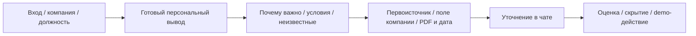

# CJM: от события к проверяемому решению

Актуализация для R-12, 26.10.2026. Это продуктовая гипотеза и путь в реализованном прототипе; интервью и коммерческая эффективность не измерялись. Точка входа «Альфа-Бизнес» смоделирована локальной авторизацией и разделом «Бизнес-аналитика», реального SSO нет.

| Этап | Потребность ЛПР | Реализованная возможность | Проверка / ограничение |
| --- | --- | --- | --- |
| Вход и доступ | Видеть свою компанию | Регистрация, заявка, одобрение admin, выбор компании | Pending не даёт доступ; должность не является ролью безопасности |
| Фокус | Получить вывод под свою работу | Произвольные должность/интересы и профиль компании | Данные могут быть неполны; unknown не превращается в «нет» |
| Лента | Быстро найти значимое | Фоновая подготовка готовых карточек, механизм, сила и актуальность | Первый проход занимает время, ready/partial/failed видны; все новости не обязаны стать карточками |
| Объяснение | Проверить причинную связь | Анализ события через подтверждённые признаки компании | Наличие продукта не подтверждает сумму/ставку; условный канал не является прогнозом |
| Доверие | Различать факт, AI и позицию банка | Основания news/company/bank, дата и страница PDF | Старый документ помечается историческим; без подходящего материала bank_view отсутствует |
| Диалог | Проверить условия для решения | Контекстный чат и постоянная история | Сохраняются отказы при нехватке источников; часть отказов исправлена, полное качество F-16 не принято |
| Обратная связь | Убрать шум / сохранить следующий шаг | Полезно/не полезно, личное скрытие/возврат, demo-action | Обращение к менеджеру сохраняется только в сервисе, внешняя банковская операция не выполняется |

Финансовый директор проверяет ликвидность и стоимость финансирования; бухгалтер — договорные условия и последствия для учёта. Для демонстрации используются две синтетические компании: металлообработка с отмеченным кредитом и строительство без отмеченного кредита, с депозитом. [Матрица 2×2 и полный путь](../demo/runbook.md), [метрики и реальные пределы доказательств](metrics.md).
